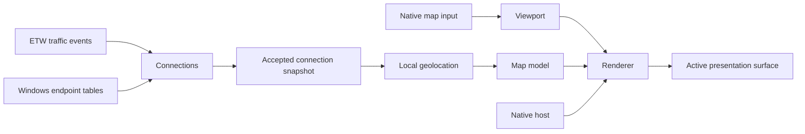

# Architecture and project organization

Mandatory implementation guidelines. Read Ownership before changing module
responsibilities; use the sections for structure, work, collection and native UI
when those paths change. These are intended implementation contracts; the tree
does not claim that source files or native proofs already exist.

The [software specification](../plans/rust-map.md) owns product behavior and
acceptance. [Porting](porting.md) owns source fidelity and rendering mechanisms;
[development](development.md) owns code rules and verification.

## Ownership

Use one Cargo package with a binary entry point and ordinary Rust modules.
Port the existing ownership structure, replacing its framework dependencies at
their existing seams.
Keep supporting records and caches beside their owner. Map the Rust Win32 UI
skill's responsibilities onto these owners; its core/app/win names do not require
another layer or a different module tree. Do not add a plugin
system, generic graphics abstraction, dependency injection framework or a second
renderer for later hosting modes.

| Owner | Responsibility | Adaptation from TinyTorrent2 |
| --- | --- | --- |
| Application | Own the latest observations, selected place, map state and commands; publish accepted changes on the UI thread. | Takes the map-related role of Inspector without torrent or Library concerns. |
| Connections | Own native event collection, endpoint reconciliation, process instances, byte intervals and observation lifetime; publish snapshots independently of drawing. | Replaces the libtorrent observation source. ETW and table reads contribute facts to this one owner. |
| Geolocation | Own local country/city MMDB readers, dataset versions and lookup results. | Port lookup policy; use a Rust MMDB reader. |
| Geography | Decode the bundled world and expose its country geometry and places. | Port the existing asset contract. |
| Map model | Group observations, arrange destinations at fitted scale, describe precision and derive selection marks. | Port MapModel; replace peer facts with PC connection facts. |
| Viewport | Own the single geographic-to-screen transform used by drawing, hit testing and navigation. | Port MapViewport calculations and limits. |
| Map interaction | Own drag, hover, inspection, keyboard commands and focus. | Port PeerMap and Navigation behavior without XAML. |
| Renderer | Own Direct2D resources, retained geometry, route paints, effects, animation and rebuild scheduling. | Translate MapRenderer's Win2D calls to their native Direct2D equivalents. |
| Host | Own the normal native window, presentation target and DPI in stage 1. Add desktop/screensaver hosting and their native commands in stage 2. | It does not own map geometry or observations. |

The [project tree](#project-tree) places these owners and their private supporting
modules. Create files when their behavior is implemented, keeping renderer-private
structures private as in the source.

One UI thread owns the native windows and all rendering resources. Native event
collection and geolocation run away from that thread. The Connections owner
accumulates all accepted traffic events before publishing a snapshot; do not
drop byte deltas by treating raw events as replaceable samples. Coalesce pending
presentation snapshots to the latest result, so slow rendering cannot build a
queue of stale observations. Compare accepted facts before arranging the model.
Coalesce data and resize changes into one preparation before the next frame;
pan and drawing do not regroup observations.

Keep `unsafe` local to native calls and FFI decoding, with explicit safety and
resource ownership obligations. Use the `windows` crate's COM ownership and
Rust lifetimes rather than an application-wide COM
wrapper. GPU device loss releases device resources and rebuilds them from plain
map state; it does not reset the view, selection or connection collection.

## Project tree

This is the intended stage 1 layout, not an inventory of implemented files.
The tree groups code by its authority; private child modules separate substantial
native, state or resource responsibilities without creating another public interface.

```text
NetMap/
|-- AGENTS.md
|-- CONTEXT.md                    # Domain glossary
|-- README.md                     # Setup, build and run instructions
|-- .gitignore                    # Generated outputs and local data
|-- .gitattributes                # Repository text normalization
|-- .cargo/
|   `-- config.toml               # Native x64 CRT linking; no runtime redistributable
|-- Cargo.toml
|-- Cargo.lock
|-- rust-toolchain.toml
|-- build.rs                      # Embed resources; generate Rust IDs from ids.h
|-- resources/
|   |-- netmap.manifest            # DPI awareness and native control activation
|   |-- netmap.rc                  # Settings shell, child pages and native resources
|   `-- ids.h                     # Resource/control ID authority for RC and Rust
|-- assets/
|   |-- world.bin                 # Unchanged source geography
|   |-- country.mmdb              # Bundled country dataset
|   `-- Attribution.md            # Asset provenance and required notices
|-- src/
|   |-- main.rs                   # Process startup and finalization
|   |-- app.rs                    # Composition, accepted facts and commands
|   |-- app/
|   |   |-- work.rs               # Worker execution, cancellation and replies
|   |   |-- settings.rs           # Preferences, defaults, draft rules and save coordination
|   |   |-- settings/
|   |   |   `-- dialog.rs         # Native shell, lazy pages, search and control events
|   |   `-- origin.rs             # Manual/default origin and request lifetime
|   |-- connections.rs            # Collector lifecycle and snapshot publication
|   |-- connections/
|   |   |-- model.rs              # Identity, reconciliation, bytes and retention
|   |   |-- etw.rs                # Trace session, schemas and event decoding
|   |   `-- tables.rs             # Native endpoint and process metadata reads
|   |-- geolocation.rs            # MMDB readers, lookup cache and dataset version
|   |-- geolocation/
|   |   `-- dataset.rs            # Download, validation and atomic installation
|   |-- geography.rs              # World decoding and geographic records
|   |-- host.rs                   # HWND lifetime, message routing and layout
|   |-- host/
|   |   |-- controls.rs           # Native commands, menus and control operations
|   |   |-- dialog.rs             # Modal/child templates, fonts and dialog-unit operations
|   |   |-- ids.rs                # Include the resource IDs generated by build.rs
|   |   `-- accessibility.rs      # Map automation and accessible interaction
|   `-- map/
|       |-- mod.rs                # Map composition and preparation boundary
|       |-- model.rs              # Grouping, placement, descriptions and marks
|       |-- viewport.rs           # Projection and view transform
|       |-- navigation.rs         # Drag/hover state and input transitions
|       |-- renderer.rs           # Drawing order, frame/rebuild budget and hits
|       `-- renderer/
|           |-- device.rs         # Device, swap-chain and GPU target lifetime
|           |-- outlines.rs       # Country paths, fills and border realizations
|           `-- routes.rs         # Route geometry, paints and shared glow
|-- tests/
|   `-- fixtures/                 # Deterministic map and collection inputs
|-- installer/
|   |-- netmap.iss                 # Inno Setup sources; Cargo supplies the version
|   |-- README.md                  # Install scope and compiler requirements
|   `-- notices/                  # Notices shipped with the executable/assets
|-- scripts/
|   |-- common.ps1                # Scripted target and Cargo invocation/metadata
|   |-- build.ps1                 # Locked Debug/Release compilation
|   |-- check.ps1                 # Formatting, Clippy and tests
|   |-- package.ps1               # Assemble the executable/assets and ZIP
|   `-- installer.ps1             # Package and compile Inno Setup
`-- docs/
    |-- agents/
    |   |-- architecture.md       # Mandatory structure, ownership and native lifetimes
    |   |-- porting.md            # Reference source and required porting mechanisms
    |   `-- development.md        # Code rules, implementation order and verification
    `-- plans/
        |-- rust-map.md           # Map and product specification
        `-- settings.md           # Settings UX, content tree and Goz porting specification
```

Add required map glyph/font files and their licences under `assets/` when porting
the controls. `country.mmdb` is the proposed distribution filename; record its
actual dataset provenance in the attribution. Optional city data, saved settings
and download temporaries follow the
[distribution contract](../plans/rust-map.md#distribution-and-saved-data)
and are not source-tree assets. Cargo's `target/` and an `artifacts/` directory
for generated captures, measurements and packages are ignored build outputs.
The [build instructions](../../README.md) describe the implemented scaffold and
commands. [Installer sources](../../installer/README.md) live in this repository;
generated setup files live under artifacts, not beside their sources. Cargo is
the version authority for executable resources, packages and setup. The initial
installer targets the current user on Windows 11 x64; collector privilege and
stage 2 screen saver installation remain separate product decisions.

**Interfaces and state.** `main.rs` wires process startup and finalization;
`app.rs` coordinates commands, accepted results and the attached presentation.
`map/mod.rs` composes Model, Viewport, interaction and Renderer behind the map's
small interface; it does not duplicate their state or perform collection.
Connections publishes immutable snapshots; Application retains the accepted one
and supplies it to map preparation and, later, exploration. The map's grouping is
a derived view of that snapshot, not another observation authority. The committed
selected place stays in Application; navigation requests changes rather than
maintaining another selection.

`connections/model.rs`, `geography.rs`, `map/model.rs`, `map/viewport.rs` and the
navigation transitions use plain Rust values without Win32/COM or I/O. Native
notifications are translated at Host; capture, cursor, focus and control effects
are applied on the UI thread. Keep each feature's event interpretation with its
owner rather than accumulating feature rules in the window procedure.

**Resources.** Host owns native windows and presentation attachment. Renderer's
private `device.rs` owns the device, swap chain and GPU target resources attached
to that window; Host requests resize/reattachment through the existing renderer.
`renderer.rs` owns draw order, the shared rebuild allowance, marker batching and
hit testing. Outlines and routes own only their corresponding retained resources;
they consume the same viewport and rebuild allowance. These files are parts of
one renderer, not interchangeable drawing backends or independently scheduled
renderers. Geolocation similarly owns its reader/cache lifetime while its private
dataset module performs validated acquisition and installation through Work.

**Growth.** Start small within each owner and extract the listed child files as
their responsibilities materialize; the tree is not an empty-file checklist.
Keep public interfaces narrow and child modules private, exposing only the types
their callers need. Avoid global `models`, `services`, `helpers` or `utils`
directories, which separate rules from their owner.

In stage 2, add `host/desktop.rs`, `host/screensaver.rs` and `host/tray.rs` for the
actual hosting behaviors, and an `app/exploration.rs` module for connection-list
commands and native composition. They consume the established snapshots, map
selection and renderer. Add a collector-process entry only if the measured
privilege requirement demands it; it reuses Connections. Do not create stage 2
files, host traits, alternate collectors or dormant controls during stage 1.

## Dependencies

Keep the dependency set small: `windows` with only the native features used,
`maxminddb` with its mapping support and required decoding dependencies, and
gzip decoding for the existing DB-IP archive format. Use standard Rust for
threading and native WinHTTP for the small HTTP requests; no async runtime or
web framework is required. Pin a stable toolchain and lockfile when implementation
starts. Keep MMDB readers memory-mapped instead of importing their data into a
new database. Reuse existing map glyphs/notices; do not bundle the torrent
application.
Add dependencies only as their behavior is implemented. The bootstrap uses only
the selected native Windows bindings at runtime and a build-time resource
compiler helper. Installer/compiler tools never become runtime dependencies.

## State and update flow



The diagram shows responsibility, not a blocking pipeline. Publish connection
facts before asynchronous geolocation completes, as TinyTorrent2 shows peers
before their lookups. Apply lookup results only if their address, observation
identity and dataset version still match. The application keeps the accepted
facts; the renderer reads prepared map state and does not query Windows or MMDB.
Geolocation updates and connection updates use the same preparation path.

Connections owns each observation's first-publication timestamp and retention;
Map model derives the [establishment highlight](../plans/rust-map.md#connection-visibility-and-traffic)
from that timestamp and the saved durations. Transport lifetime and visual age
are independent facts, not overlapping active/bright/fading flags. During grouping,
retain the newest introduction timestamp and measured directional rates needed
by each destination so frames do not rescan the observation collection.

Renderer evaluates those ages and traffic pulses using one monotonic frame clock.
Reuse retained route geometry and adjust sharp guide/marker opacity or brush
position for the temporal effect; keep the moving pulse out of the cached blur
input so it does not force a new glow/effect surface each frame. Use the existing
frame timer only during visible fades, measured pulses, activity interpolation or
pending rebuilds. A static bright hold needs only a wake at its next transition;
there are no per-connection timers, animation objects or worker tasks. Closing a
socket does not discard the resources still needed to finish its highlight.

Use one event/update path: accept facts or a command, update its owner, apply
structural changes, refresh affected presentation, then perform dependent focus,
work or dialog effects. Preserve control/user-owned focus, selection, scroll,
caret and typed input during ordinary refresh. Skip unchanged native setters
and rectangles. End model borrows before native calls or modal dialogs, which
can dispatch nested messages; recheck command validity after reentry and stop
effects when the window is destroyed.

## Origin transitions

Viewport owns meridian rebasing under the
[origin and viewport contract](../plans/rust-map.md#origin-and-viewport).
Rebase its relative centre before using the changed meridian and invalidate
meridian-dependent geometry through Renderer. Ending a drag after this transition
must not restore coordinates from the old meridian.

## Background work and shutdown

`app/work.rs` is the single native thread-launch and worker-registration
location, including the dedicated trace consumer. Application chooses and routes
work; Connections, Geolocation, origin and settings retain their own policies and
perform their native operations on registered workers. The work module owns
bounded execution, cancellation handles and the application-lived reply endpoint,
not a second collection model or a universal task framework. Modules such as
`etw.rs` provide the worker body and native resources, not independent spawns.
The reply endpoint outlives any particular presentation HWND.

Keep disk, network, trace consumption, MMDB work and other potentially blocking
operations off the message loop, including channel waits, worker-held locks and
joins. Bound worker counts, queues and whole-collection passes, including input
preparation and result application on the UI thread.
Supersede work only within its purpose; explicit dataset installation and required
writes retain their integrity guarantees. Controls and Renderer use this work
path rather than starting threads or waiting for workers.

Replies are typed and carry their work owner, purpose and current request/lifetime
identity.
A changed route or manual-origin choice supersedes an earlier origin lookup;
a dataset replacement supersedes earlier location results. Application-owned
connection, origin, geolocation and dataset replies are checked against the
application/request/dataset lifetime, never the HWND that happened to be visible
when work began. Apply valid completions through Application's reply endpoint,
which survives host changes, and refresh the currently attached presentation.
If no presentation is attached during a transition, keep the accepted result
and present it when attachment completes. Only presentation-specific work also
requires that presentation's lifetime to match. Retire the old presentation's
delivery registration before destroying its HWND so late work cannot address a
recycled handle; a host change does not cancel current application-owned work
or discard its completion.

Exit stops accepting new work, retires UI replies, requests cancellation and
removes the visible windows promptly. Ordinary close in desktop-enabled mode is
a host transition instead. Screensaver dismissal retires that presentation and
its subscriptions; it does not stop a collector still owned by another live
presentation. Actual process shutdown gives off-UI cleanup the
[specified deadline](../plans/rust-map.md#responsiveness-and-exit); it never
joins from close/destroy handlers. The deadline check must remain runnable when
a cleanup call stalls. After cooperative cleanup, exit
normally; if own workers remain uncooperative at the deadline, initiate
`TerminateProcess` for the current process rather than returning from `main`
with those workers still running. Normal exit can deadlock during DLL detach
when a worker holds a required lock. This bounds application cleanup and fallback
initiation, not kernel-level process removal: Windows may still need to complete
or cancel pending I/O. Measure those stages separately.

Stop only the process-owned ETW session and close its consumer; retain callback
state until `ProcessTrace` has returned. Cancellation/`CloseTrace` does not mean
callbacks have already finished. Similarly, retain MMDB mappings and worker
inputs until their readers finish. If a native call outlives finalization, its
state remains owned until process exit; never free it early or terminate its
thread to satisfy the deadline. Handle an interrupted own trace on the next run
under the existing session-ownership rule.

Origin/download requests use cancellable native handles and finite network
timeouts. Serialize settings replacements so an older write cannot overwrite a
newer choice; request the final accepted settings snapshot at exit. Settings and
dataset writes publish only validated/flushed same-directory temporary files
through atomic replacement, retaining or recovering the previous usable file
if the replacement primitive partially fails. Keep the previous dataset
recoverable until replacement and reader reopening succeed. Reader cleanup
waits for in-flight lookups off the UI thread. Cancellation or fallback before
commit leaves the last committed settings/dataset usable; a pending settings
choice may not have been saved. Unused temporaries may be discarded on the next
attempt. Do not wait on these operations from a native dialog, map handler or
screensaver dismissal path.

## Native collection

Use one Connections owner with complementary native sources: real-time ETW
provides traffic events and byte measurements; endpoint-table reads seed and
reconcile current socket facts. These feed one authority, not alternative
monitoring implementations. No raw packet capture, driver, network proxy or
separate EStats rate path is planned.

- Start a named application-owned real-time ETW session for the Windows system
  network events; do not take over or stop another tool's kernel logger. Consume
  TCP and UDP send/receive events for IPv4 and IPv6 plus relevant TCP lifecycle
  events. Decode the event's provider/version and payload, including the actual
  process identity; the event-header PID can belong to the thread logging it.
- Start event collection before the initial endpoint snapshot and reconcile the
  two by identity/timestamp, so startup races do not duplicate sockets or lose
  new traffic. Enumerate current TCP endpoints with `GetExtendedTcpTable` for
  IPv4 and IPv6 and owning PIDs. Reconcile periodically, initially every two
  seconds, so existing idle connections and missed TCP close events settle.
- Read UDP endpoint tables for local socket ownership where needed; build remote
  UDP flows from observed datagrams. A table entry alone cannot identify its
  remote peer. Preserve IPv6 scopes and normalize IPv4-mapped addresses once
  at ingestion.

Use available ETW connection identifiers and timestamps as correlation evidence
within the trace lifetime, not as permanent observation identities. Decode byte
order and pointer-sized fields from the actual event schema, not a guessed
packed struct. Normalize receive endpoints in the opposite direction from send
endpoints so both directions meet at one local/remote identity. The
[identity and rate contract](../plans/rust-map.md#collection-and-identity) owns
incarnation, uncertainty, retention and byte-accounting behavior.

Bound process, address and native-event buffers by current use; record lost
events if ETW buffers overrun.

Use a stable order and compare only display-relevant facts before invalidating
the map. A changing collection timestamp or an identical endpoint table does
not cause regrouping or redraw. Stage 2's last-seen text can refresh separately
when visible. Cache metadata once per live process instance and locations once
per address/dataset version; do not perform per-event process opens or MMDB reads.

If ordinary desktop/screensaver launch cannot obtain the required rights in
stage 2, isolate this same collector module in an explicit collector role and
send read-only snapshots through a local, user-restricted named pipe. The
renderer remains in the ordinary user's process. Add that process seam only
when the stage 1 privilege result requires it; never implement another collector
for the saver or request elevation from a screensaver preview/dismissal path.

## Native presentation

The GPU map is an explicitly approved custom surface. Preserve its Direct2D,
DirectWrite, D3D11 and DXGI implementation and optimization parity. This approval
does not extend to drawing replacements for buttons, menus, lists or other
standard controls. Compose native Win32/common controls around the map. A new
custom control needs a concrete behavior native composition cannot provide and
explicit approval before implementation.

Keep the surrounding UI minimal: normal window chrome, native menus and the
[specified Settings shell](../plans/settings.md). Adapt Goz's native dialog
templates and mechanisms using that specification's source map. The map remains
the only custom surface.

`app/settings.rs` owns typed preferences, canonical defaults, draft validation,
the page/caption catalogue and serialized save coordination. Keep its rules in
plain Rust without HWND or control reads. Its private `settings/dialog.rs` owns
the native shell, lazy child pages, local layout, draft-to-control refresh and
notification translation. Keep the small page implementations together there
until a concrete responsibility warrants a private split. This is a feature
owner with native composition, not a second application model or settings engine.

`host/dialog.rs` provides only the native template/loop/font/DPI operations the
feature needs; `host/controls.rs` owns common-control operations. `resources/ids.h`
is the single numeric ID source, generated into Rust by `build.rs` and included
at `host/ids.rs`. Templates in `resources/netmap.rc` contain control composition;
the page catalogue owns user-visible captions/search vocabulary and Host applies
them to resource IDs. Native IDs stay out of the plain preference model.

Settings commands share the application settings, origin, dataset and later
hosting owners with their menu counterparts. Disk/network work uses `app/work.rs`;
accepted saves and explicit operations outlive a closed Settings dialog. Deliver
results through the application endpoint, then refresh only a still-attached
matching dialog instance. Hold neither a mutable application borrow nor a worker
lock across the modal loop. Destruction releases page HWNDs and UI resources,
without destroying application work state or introducing another worker launcher.

Before changing UI, define the task, command priority, applicable data states,
narrow/normal/wide behavior and keyboard paths. Keep required commands reachable;
use the existing palette, DPI units, focus, High Contrast and reduced-motion
contracts. Similar pixels alone do not establish accessible map interaction.

Host coordinates changed layout regions; each native child paints itself. Use
control-supported buffering and batched changed positions, with narrowly scoped
redraw suppression only for an observed defect. Keep map caches inside Renderer;
avoid a whole-window backbuffer or blanket redraw policy around native children.
Frame scheduling follows the [optimization parity requirements](porting.md#optimization-parity-checklist).

Pause presentation when the display/session is inactive or the window is
minimized; resume with the latest observations. Keep collection and its bounded
aggregation independent of visible frames. Use DXGI occlusion feedback where
available. In stage 2, do not infer wallpaper occlusion solely from Explorer's
parent-window visibility.

### Stage 2 hosts and exploration

Live background hosting uses Explorer's desktop window arrangement, commonly
involving Progman/WorkerW. That arrangement is not a documented live-wallpaper
contract. `SetParent(NULL)` alone does not establish the required position behind
icons. Verify attachment, styles, z-order and DPI on the actual Windows 11 build
at the start of stage 2 background work; this is not a stage 1 feasibility gate.

Prefer retaining the same native map window when reparenting is reliable. If
Windows requires a new HWND or swap chain, replace only that presentation target;
Application, Model, Viewport and Renderer remain the same owners. Preserve
device caches where valid. Test cross-process DPI behavior rather than assuming
a per-monitor-aware manifest makes reparenting safe.

Screensaver launches use the same compiled map modules and collection policy.
Within a saver instance, displays share observations and geography; native
targets do not create another collector or independent feature authority.

Exploration reuses map hit testing and destination keys to select contributing
observations from the accepted snapshot. It does not run a second geolocation
or grouping calculation to populate the details.
